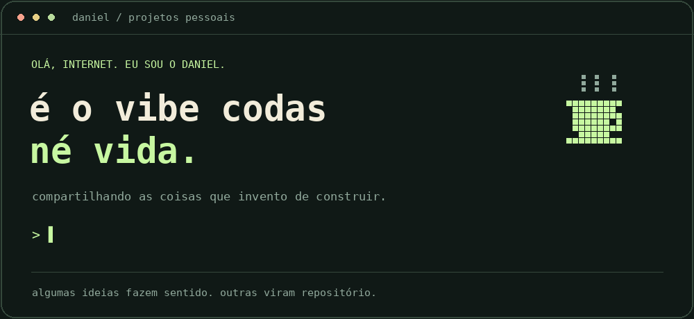
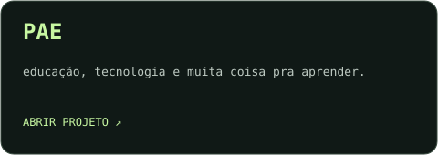
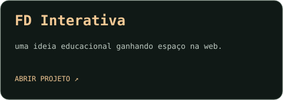

  

  estudante de economia, curioso por IA e cheio de ideia maluca. 
  compartilhando meus projetos pessoais e as coisas que invento de construir.

  
  

### coisas que saíram da minha cabeça ↴

  
  

### ☕ um pouco do caos

<b>clica aqui pra conhecer a pessoa por trás dos commits</b>

 

- 📚 estudo Economia e vivo pensando em como as coisas funcionam.
- 🤖 gosto de IA pelo tanto de ideia que ela me ajuda a tirar do papel.
- 💡 tenho um fraco por produtos, negócios e um “será que dá pra fazer isso?”.
- ⚽ fora da tela, também tem futebol.
- 🧪 por aqui tem experimento, aprendizado e projeto pessoal. tudo em construção, inclusive eu.

<b>como nasce um projeto por aqui</b>

 

“tive uma ideia” → “deve ser simples” → 37 abas abertas → “agora foi”

às vezes sai um produto. às vezes sai uma boa história.

---

<i>algumas ideias fazem sentido. outras eu descubro no caminho.</i>

